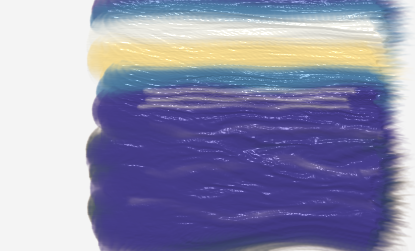

> **This is the `fixed-tip` branch.** The bristle solver is gone; the brush is a
> stamped tip mask instead. For the bristle-simulation line — and the full README —
> see [`main`](../../tree/main).

# fluid-paint-oil

A fork of [David Li's Fluid Paint](https://github.com/dli/paint) tuned toward **oil
painting** — strokes that hold a consistent width, mix wet-on-wet, and keep their
impasto relief.



> Painted entirely in the engine. Ultramarine, cerulean, prussian blue, titanium
> white and naples yellow, all blended wet-on-wet.

The upstream engine is excellent at *fluid*. This fork is about making it behave
like a **loaded bristle brush pressed into thick paint** instead.

Everything here is WebGL 1, no build step, no dependencies.

> **Note on language:** the code comments and the design notes are written in
> Korean, because that is the language this was developed in. The sections below
> summarise the technical substance in English.

---

## Running it

No build step. Serve the directory with any static server:

```bash
npx serve .
```

Then open `fluid-paint/index.html`.

It needs a WebGL 1 context with `OES_texture_float`.

---

## What changed, and why

Each change below came from comparing against a reference — either the upstream
engine itself, or video of a real oil-painting app — and measuring the paint
texture rather than eyeballing it. The reasoning for each one is in
[`docs/changes.md`](docs/changes.md).

### The brush kept splaying into a comb

Upstream, a single press produced a starburst: every bristle shot off in its own
direction. The plane constraint only looks at `z`:

```glsl
if (position.z < 0.0) position.z *= 0.5;
```

Press the brush and the bristles get pushed flat, but nothing holds them together
sideways. Over twenty constraint iterations each hair wanders off alone.

A real brush is bound in a ferrule. Adding a radial constraint — pull any bristle
that strays past `gather × scale` back toward the shaft, keeping a quarter of the
overshoot so the edges still fray — turns a press into a **round dab** and a
stroke into a band of **consistent width**.

### The brush was always lying down

Bristles are `4.5 × scale` long but the ferrule sits at `2.0 × scale`, so more than
half of each bristle's length is buried below the canvas. The result reads as a
brush dragged on its side, every hair visible. Real brushes are often held upright,
where only the tip is pressed and the grain is subtle.

`Brush Upright` moves the ferrule between those two extremes. `Brush Tilt` leans the
whole bundle by a fixed angle that is held for the duration of a stroke.

### Bristle trails smeared behind the brush

Only the root vertex was pinned, so the other nine flopped and each left a long
trailing line. `Brush Stiffness` pins the first *N* segments of every bristle; at
six of ten the brush holds its shape while the tip still gives.

Watch out: pinning two adjacent vertices makes both weights zero in
`distanceconstraint.frag`, and `myWeight / (myWeight + otherWeight)` becomes `0/0`.
The NaN propagates down the bristle and nothing renders at all.

### Fast strokes looked nothing like slow ones

Upstream moves the brush to the new mouse position once per frame and joins the gap
with one capsule. Draw slowly and the capsules pile up into a thick clump; draw
quickly and you get a few long, angular capsules.

Worse, bristle velocity *is* the per-frame displacement
(`projectedPosition - position`), so a fast stroke shoves the fluid proportionally
harder — the paint smears out behind the brush. A real brush doesn't push harder
when you move faster; it just lays down less.

Two fixes: step the brush along the path in increments of `0.3 × radius` (up to six
sub-steps per frame), and clamp bristle speed before it reaches the velocity splat.

Thickness variation along a stroke (σ/μ), lower is more even:

| frames (fewer = faster stroke) | before | after |
| --- | ---: | ---: |
| 8 | 0.257 | **0.077** |
| 20 | 0.175 | **0.076** |
| 60 | 0.041 | 0.035 |

### Paint stretched like syrup, and scrubbing dug a hole

Both symptoms share a cause: `SPLAT_VELOCITY_SCALE` is high enough that paint
migrates outward from wherever the brush works. Spiral-fill an area and measure
thickness from the centre out:

| `Paint Slip` | centre → edge |
| --- | --- |
| 1.0 (upstream) | 25 → 31 → 32 → 33 → **36** |
| 0.3 (default) | 32 → 41 → 42 → 31 → 18 |
| 0.1 | **29 → 27 → 22 → 16 → 9** |

Upstream pushes paint to the rim and leaves the middle hollow. Lower it and paint
stays where the brush put it, building the gentle mound you actually get when
scrubbing with a brush.

### Bristle density was uniform, not centre-weighted

Upstream uses `sqrt(i/N)` — a Vogel/sunflower distribution, uniform per unit *area*.
Mathematically even, but a real brush is dense in the middle and sparse at the rim.
`pow(i/N, density)` opens that up; the outermost bristle still lands at `r = 1`, so
the brush does not change size.

---

## Controls

| | |
| --- | --- |
| 물감 색 — Paint colour | Large SV square, hue bar, and a paint-amount bar |
| 물감 묽기 — Fluidity | Upstream's fluid parameter |
| 붓털 개수 — Bristle count | Upstream's bristle count |
| 붓 크기 — Brush size | |
| **붓 세운 정도** — Brush upright | Ferrule height: laid down ↔ held upright |
| **붓 기울기** — Brush tilt | Fixed lean angle, held for the whole stroke |
| **물감 끌림** — Paint slip | How far paint is dragged along with the brush |
| **붓털 밀도** — Bristle density | Uniform ↔ centre-weighted |
| **붓털 묶임** — Bristle gather | How far bristles may stray from the shaft |
| **붓 뻣뻣함** — Brush stiffness | How many bristle segments hold their shape |

Bold rows are new in this fork.

### Paint amount

The bar to the right of the colour picker. Upstream never labelled it, and it is
not obvious: it sets **how much paint a single bristle lays down per splat**, and
that one value feeds three things — colour coverage, impasto height (the texture's
alpha channel is the height field), and how hard the brush pushes the fluid.

Low is a translucent glaze; high is thick, opaque, draggable paint.

---

## Colour

Paint mixes in a **RYB** pigment space, trilinearly interpolated between eight
corners — so blue over yellow gives green, as it should.

A palette of sixteen classic oil pigments ships with it. The HSV values were solved
numerically by minimising CIE Lab ΔE **against the engine's own conversion**, called
directly in the browser. Do not reimplement the conversion to solve against: doing
that once flipped the hue direction and produced purple where yellow belonged.

Blues and black land 7–10 ΔE from their targets. The darkest corner of this RYB
model is a brown at `(0.2, 0.094, 0.0)`, so neutral black and deep blue are simply
outside its gamut. That is the model, not the palette — switching the colour mode
to Digital (RGB) reaches them.

---

## Branches

- **`main`** — the bristle-simulation line described above.
- **`fixed-tip`** — a different experiment. The bristle solver is replaced entirely
  by a stamped tip mask (Krita's "alpha mask" model, libmypaint's
  `elliptical_dab_ratio`), with arc-length resampling, a 1 € input filter, pressure
  and tilt, and a smudge model that picks colour up across the brush's width. See
  [`docs/fixed-tip-design.md`](docs/fixed-tip-design.md).

Both are kept because they fail differently and it is useful to see both.

---

## Documents

- [`docs/changes.md`](docs/changes.md) — every modification, why it was made, and
  the measurements behind it. Also how to A/B against pristine upstream.
- [`docs/fixed-tip-design.md`](docs/fixed-tip-design.md) — the fixed-tip branch's
  design and the primary sources behind it.
- [`docs/research/`](docs/research) — background research on brush presets and oil
  painting engines (Korean).
- [`docs/upstream-readme.md`](docs/upstream-readme.md) — the original README.

---

## Licence

MIT, as upstream. David Li's copyright notice is preserved in [`LICENSE`](LICENSE);
modifications in this fork are added under the same terms.

The fixed-tip branch takes **concepts only** from libmypaint (ISC) and Krita (GPL) —
parameter semantics and model structure, documented in `docs/fixed-tip-design.md`.
No code from either project is included.
