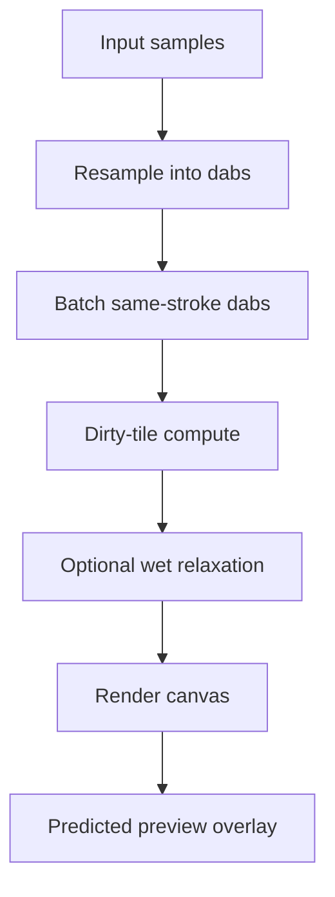

# 괴짜 복원소용 유화 질감 엔진 기술 조사서

버전 0.1 · 기준 플랫폼 Unity 6 / URP / iPad / Apple Pencil

## 0. 결론부터

2인이 Art Set 4 전체를 그대로 복제하는 것은 현실적이지 않지만, **복원 게임에 최적화된
고품질 유화 엔진**은 단계적으로 만들 수 있습니다. 단, 이를 “붓 셰이더 하나”로 보면 실패합니다.
제품 수준의 유화 감각은 다음 네 시스템의 합입니다.

1. 입력: Pencil의 압력·기울기·고주파 위치를 낮은 지연으로 획으로 바꾼다.
2. 도포: 붓 모양과 털 자국에 따라 색, 물감 양, 높이, 젖음을 캔버스에 놓는다.
3. 상호작용: 젖은 물감끼리 섞이고 끌리며, 붓이 캔버스 색을 집어 간다.
4. 표시: 높이와 젖음이 조명에 반응해 임파스토와 기름 광택으로 보인다.

2인 팀의 최선은 완전한 유체역학을 먼저 만드는 것이 아니라, 사용자가 즉시 느끼는 순서대로
정확도를 올리는 것입니다. 권장 우선순위는 **선의 안정성 → 붓 질감 → 높이·광택 → 젖은
끌림 → 안료 혼색 → 다층 물감 → 유체 흐름**입니다. 이 순서를 뒤집으면 기술적으로 흥미로운
시뮬레이션을 만들고도 그리기 불편한 앱이 될 가능성이 큽니다.

현재 동봉한 v0.1 코드는 첫 네 항목의 골격을 실행 가능한 Unity 구조로 옮겼습니다. 진짜
Kubelka–Munk 혼색, 공간적인 붓 reservoir, 다층 wet/dry stack은 연구 결과와 구현 경로를
명시했지만 아직 프로덕션 코드로 주장하지 않습니다.

---

## 1. 제품 목표를 기술 요구사항으로 번역하기

이 프로젝트의 특징은 “손상 영역만 칠하는 미니게임”이 아니라 **명화 전체가 캔버스**라는
점입니다. 따라서 엔진은 다음 두 사용 사례를 동시에 만족해야 합니다.

### 복원 플레이

- 작은 결손부터 화면 절반 규모의 결손까지 대응한다.
- 색, 명암, 경계, 붓 방향, 물감 두께를 복원의 평가 요소로 쓸 수 있어야 한다.
- 손상 영역 밖에도 그릴 수 있지만 원작을 훼손하면 별도 감점을 줄 수 있어야 한다.
- 지우개가 아니라 용제, 스크레이퍼, 팔레트 나이프처럼 세계관에 맞는 수정 도구가 필요하다.
- 정답 픽셀 복제만 요구하면 창작 자유가 사라지므로, 평가 정확도와 허용 오차를 단계별로 조절한다.

### 자유 그림 도구

- 빈 캔버스와 명화 위에서 모두 쓸 수 있어야 한다.
- 느린 선이 떨리지 않고 빠른 선이 끊기지 않아야 한다.
- 압력에 따른 크기와 유량이 예측 가능해야 한다.
- 여러 번 덧칠했을 때 색과 두께가 누적되어야 한다.
- 젖은 색을 끌거나 섞는 행동이 결과에 남아야 한다.
- 그림 앱 사용자가 “게임 부가 기능”이라고 느끼지 않을 수준의 undo, 색 선택, 확대, export가 필요하다.

두 모드를 하나의 엔진에서 제공하되 데이터는 분리해야 합니다. `BasePainting`은 불변이고,
플레이어가 만든 `WetPaint`, `DryPaint`, `Height`, `Wetness`가 그 위에 놓입니다. 손상 마스크는
그리기를 막지 않고 점수 계산에만 사용합니다.

### 성공 기준

“유화처럼 보인다”보다 더 엄격한 기준이 필요합니다.

- 선을 그은 뒤가 아니라 **그리는 중**에 물감처럼 느껴지는가?
- 같은 색 두 개를 섞을 때 결과를 학습하고 예측할 수 있는가?
- 낮은 압력의 스컴블링과 높은 압력의 덮기가 구분되는가?
- 마른 층 위의 새 획과 젖은 층 위의 새 획이 다르게 행동하는가?
- 20분 사용 후에도 iPad가 심하게 스로틀링하지 않는가?
- 복원 게임을 끝낸 사용자가 빈 캔버스를 열고 싶어 하는가?

---

## 2. 실제 유화에서 가져와야 할 현상

모든 물리 현상을 재현할 필요는 없습니다. 아래는 지각 영향과 구현 비용을 기준으로 분류한
목록입니다.

| 현상 | 사용자가 느끼는 단서 | 구현 비용 | 우선순위 |
|---|---|---:|---:|
| 불규칙한 brush footprint | 털 사이가 갈라지고 가장자리가 살아 있음 | 낮음 | P0 |
| 압력별 면적·유량 | 눌러 칠하는 손맛 | 낮음 | P0 |
| 물감 질량 누적 | 덧칠할수록 덮이고 두꺼워짐 | 낮음 | P0 |
| height 기반 임파스토 | 저각도 조명에서 붓 능선이 보임 | 중간 | P0 |
| wetness 기반 광택 | 젖은 부분이 더 매끄럽고 반짝임 | 낮음 | P0 |
| 젖은 물감 끌림 | 새 획이 아래 색을 끌고 감 | 중간 | P1 |
| 붓 pickup/오염 | 긴 획에서 붓 색이 서서히 변함 | 중간~높음 | P1 |
| 감산 안료 혼색 | 노랑+파랑이 회색 RGB 평균이 아니라 녹색 방향 | 중간~높음 | P1 |
| 얇은 glaze | 아래색이 비치는 투명막 | 중간 | P1 |
| scumbling | 높은 부분만 마른 붓으로 긁힘 | 중간 | P1 |
| 다층 pigment stack | 덮인 색이 긁을 때 다시 드러남 | 높음 | P2 |
| 비뉴턴 유체 흐름 | 힘이 클 때 흐르고 멈추면 형태 유지 | 매우 높음 | P3 |
| 개별 bristle dynamics | 털이 갈라지고 휘며 물감을 운반 | 매우 높음 | P3 |

유화는 물처럼 계속 퍼지는 얇은 액체가 아닙니다. 전단박화(shear-thinning) 성격 때문에 힘을
받을 때 잘 움직이고, 힘이 사라지면 붓 골과 봉우리가 유지됩니다. Stuyck 등의 모바일 논문은
얕은 물 방정식을 유화에 맞게 수정하고 점성, 중력, 점탄성, 안료 이류를 포함했습니다. 그러나
같은 논문도 브러시는 복잡한 탄성 모델 대신 texture stamp로 단순화했습니다. 이 선택은 2인
모바일 팀에 특히 중요합니다: **캔버스 물성에 계산을 쓰고, 붓 모양은 좋은 데이터로 속인다**는
전략입니다.

참고: [Real-Time Oil Painting on Mobile Hardware, DOI 10.1111/cgf.12995](https://onlinelibrary.wiley.com/doi/full/10.1111/cgf.12995)

---

## 3. 선과 붓자국: 품질의 첫 번째 병목

### 3.1 이벤트를 그대로 찍으면 안 되는 이유

터치 이벤트는 시간 간격이 일정하지 않고 렌더 프레임과 동기화되지 않습니다. 이벤트마다
한 번씩 원을 찍으면 빠른 획에는 구멍이 생기고 느린 획은 지나치게 진해집니다. 해결책은 원시
입력을 받은 뒤 캔버스 픽셀 공간의 누적 거리로 다시 샘플링하는 것입니다.

붓 반지름을 `r`, 반지름당 dab 수를 `d`라 하면:

\[
s = \frac{r}{d}
\]

`s`가 dab 간 거리입니다. MyPaint 계열 엔진도 반지름 기준 dab 밀도를 중요한 brush setting으로
둡니다. 기본 `d = 2.0~2.5`에서 시작하고, 거친 털은 낮게, 에어브러시처럼 매끈한 브러시는 높게
조정합니다. 압력으로 반지름이 바뀌면 다음 간격도 새 반지름으로 계산합니다.

### 3.2 필터링과 지연

이동 평균은 떨림을 줄이지만 선이 손을 뒤따라오는 지연을 만듭니다. 동봉 코드의 One Euro
Filter는 저속에서 cutoff를 낮춰 떨림을 억제하고, 고속에서 cutoff를 높여 지연을 줄입니다.
조정 순서는 다음과 같습니다.

1. `beta = 0`으로 둔다.
2. 아주 천천히 선을 그리며 `minCutoff`를 낮춰 떨림을 제거한다.
3. 빠른 S자를 그리며 `beta`를 올려 추종 지연을 줄인다.
4. 위치와 압력의 필터 계수는 별도로 둔다. 압력을 과하게 필터링하면 획 끝이 뭉친다.

원 논문과 구현: [1€ Filter](https://github.com/casiez/OneEuroFilter)

### 3.3 Apple Pencil 입력

Unity의 포인터 API는 압력·고도각·방위각을 제공하지만, painter-grade iPad 경험에는 UIKit의
coalesced touches와 predicted touches를 직접 받는 경로를 검토해야 합니다.

- coalesced touches: 한 번의 앱 이벤트 사이에 기기가 수집한 중간 위치들을 돌려준다.
- predicted touches: 다음 위치의 추정값을 미리 그려 지연을 줄인다.
- 예측점은 정답이 아니다. 다음 실제점이 오면 임시 레이어를 지우고 다시 그려야 한다.
- 실제점과 coalesced 점은 히스토리와 점수에 기록한다.
- predicted 점은 preview에만 사용하고 저장, 점수, pickup 시뮬레이션에는 넣지 않는다.

Apple 공식 문서: [High-fidelity coalesced touches](https://developer.apple.com/documentation/uikit/getting-high-fidelity-input-with-coalesced-touches),
[Predicted touches and latency](https://developer.apple.com/documentation/uikit/minimizing-latency-with-predicted-touches)

동봉한 Objective-C++ 브리지는 이 입력을 Unity C# callback으로 전달하는 최소 초안입니다.
실제 제품에서는 화면 회전, safe area, render viewport, 여러 창, 손가락 gesture와 Pencil의 동시
인식, 앱 pause/resume을 추가 검증해야 합니다.

### 3.4 붓 footprint

원형 soft brush로는 유화 느낌이 나지 않습니다. 최소 두 데이터가 필요합니다.

- shape/coverage mask: 어느 픽셀에 얼마나 닿는가.
- bristle load map: 붓 끝 각 위치에 색과 물감이 얼마나 남았는가.

Stuyck 논문은 회색조 brush shape가 도포량을 조절하고 별도 reservoir texture가 붓 끝의 안료를
저장하도록 했습니다. 압력이 높을수록 아래 pigment layer와 상호작용하며, 붓과 캔버스가
양방향으로 안료를 교환합니다. 제품의 P1 구현은 32×32 또는 64×64 reservoir를 브러시별로
두고, 매 dab에서 다음을 수행하는 것이 적절합니다.

```text
contact = shapeMask * pressureContact
canvasToBrush = canvasPigment * pickupRate * canvasWetness * contact
brushToCanvas = brushPigment * depositRate * contact
brushPigment += canvasToBrush - brushToCanvas
canvasPigment += brushToCanvas - canvasToBrush
brushPigment = lerp(brushPigment, selectedPigment, reloadRate)
```

모바일 논문 구현은 각 stamp에서 선택 색으로 붓을 일부 재충전했습니다. 이 재충전율은 “튜브에서
계속 색이 나오는 디지털 브러시”와 “한 번 묻혀 쓰는 실제 붓” 사이의 게임 디자인 손잡이가 됩니다.

### 3.5 스캔 기반 붓 데이터

개별 털을 물리적으로 시뮬레이션하지 않아도, 실제 붓으로 만든 흑백 mark를 촬영·정규화하여
mask atlas를 만들면 큰 품질 향상이 있습니다. RealBrush는 실제 매체 예제를 캡처하고 특성을
분해해 실시간으로 합성하는 데이터 중심 접근을 보여 줍니다. 2인 팀은 이를 그대로 구현하기보다
“좋은 실물 footprint를 입력 데이터로 쓴다”는 원칙을 채택하는 편이 효율적입니다.

참고: [RealBrush: Painting with Examples of Physical Media](https://research.adobe.com/publication/realbrush-painting-with-examples-of-physical-media/)

---

## 4. 캔버스 상태 표현

### 4.1 RGB 이미지 한 장이 부족한 이유

RGB는 현재 보이는 색만 나타냅니다. 다음 질문에 답할 수 없습니다.

- 이 픽셀의 물감이 두꺼운가?
- 아직 젖어 있어 섞여야 하는가?
- 표면이 매끄러워 반짝이는가?
- 아래에 어떤 색 층이 묻혀 있는가?
- 긁으면 원작이 나오는가, 이전 물감이 나오는가?

따라서 색과 재료 상태를 분리합니다. v0.1은 다음 두 RT를 씁니다.

```text
Paint RGBAHalf:    R,G,B = linear color, A = coverage / mass
Material RGBAHalf: R = height, G = wetness, B = roughness, A = reserved
```

두 장의 scratch RT가 있어 총 네 장입니다. 1024²에서 RGBAHalf 한 장은 약 8 MiB이므로 동적
상태는 약 32 MiB입니다. 2048²에서는 약 128 MiB가 되어 급격히 부담이 커집니다. 그러므로
플레이 중 simulation은 1024² 또는 1536², 최종 저장은 획 명령을 2048² 이상으로 재생하는
방식이 합리적입니다.

### 4.2 프로덕션 포맷 절감

실기기 검증 뒤 다음처럼 줄일 수 있습니다.

- Paint: `R16G16B16A16_SFloat` 유지. 혼색과 저알파 누적에 여유가 있다.
- Material: `R16G16_SFloat`로 height/wetness만 저장.
- roughness는 wetness와 brush medium에서 유도하거나 `R8` 타일로 분리.
- dry height는 주기적으로 base material에 bake.
- 보이지 않는 scratch는 한 세트만 재사용.

Unity에서는 random-write 가능 여부를 `SystemInfo.IsFormatSupported(format,
GraphicsFormatUsage.LoadStore)`로 확인해야 합니다. RenderTexture는 생성 전에
`enableRandomWrite`가 켜져 있어야 compute shader가 쓸 수 있습니다.

Unity 공식 문서: [EnableRandomWrite](https://docs.unity.com/en-us/engine/6000.7/script-reference/unityengine/rendertexturecreationflags/enablerandomwrite),
[IsFormatSupported](https://docs.unity3d.com/6000.0/Documentation/ScriptReference/SystemInfo.IsFormatSupported.html)

### 4.3 dirty rectangle

반지름 24 px 붓 하나 때문에 1024² 전체를 매 dab 갱신하면 대부분의 GPU 작업이 낭비입니다.
brush bounds만 compute dispatch하고 그 구역만 scratch에서 authoritative RT로 복사합니다.

이 구조에는 중요한 함정이 있습니다. source와 destination을 매 dab 교환하면서 destination의
나머지 영역을 동기화하지 않으면, 다음 dab 때 캔버스 바깥 영역이 오래된 상태로 돌아갑니다.
동봉 코드는 source를 읽고 scratch의 dirty rect를 완전히 쓴 뒤 `Graphics.CopyTexture`의 region
overload로 같은 rect만 source에 되돌립니다. Unity는 이 API가 GPU 측 subregion copy를 지원한다고
문서화합니다.

참고: [Graphics.CopyTexture](https://docs.unity3d.com/ScriptReference/Graphics.CopyTexture.html)

---

## 5. 안료 혼색

### 5.1 왜 RGB lerp가 틀리는가

RGB는 모니터가 내는 빛을 표현한 세 값이지, 물감이 파장별로 빛을 흡수·산란하는 방식이 아닙니다.
두 RGB를 선형 보간하면 화면색의 중간은 만들지만 실제 안료 혼합의 어두워짐, 탁해짐, 특정 색상
경로를 재현하지 못합니다. 또한 같은 RGB로 보이는 두 실제 안료도 스펙트럼이 달라 섞은 결과가
달라질 수 있으므로 RGB만으로 유일한 물리 정답을 복원할 수 없습니다.

### 5.2 Kubelka–Munk 개념

불투명 안료의 간단한 2-flux 모델은 파장별 흡수 계수 `K(λ)`와 산란 계수 `S(λ)`를 사용합니다.
안료 농도 `c_i`로 혼합할 때 기본 형태는 다음과 같습니다.

\[
K_{mix}(\lambda) = \sum_i c_i K_i(\lambda), \qquad
S_{mix}(\lambda) = \sum_i c_i S_i(\lambda)
\]

무한히 두꺼운 층의 반사율은 `a = 1 + K/S`일 때 다음 형태로 얻습니다.

\[
R_\infty = a - \sqrt{a^2 - 1}
\]

마지막으로 illuminant와 color matching functions를 적분해 XYZ, 이후 linear RGB로 바꿉니다.
중요한 점은 “공식”보다 **신뢰할 수 있는 pigment spectrum 또는 K/S 데이터**입니다. 가짜
스펙트럼을 넣으면 노랑+파랑도 그럴듯하지 않습니다.

### 5.3 가능한 세 구현 계층

| 계층 | 저장/연산 | 장점 | 단점 | 권장 단계 |
|---|---|---|---|---|
| A. 보정 RGB/LUT | RGB + 3D/2D LUT | 빠르고 작음 | 물리적 일관성 낮음 | v0.1 |
| B. RGB→대표 스펙트럼 | 7~10 band 변환 후 혼합 | 임의 색 선택 가능 | 변환 비용, metamer 한계 | v0.2 |
| C. 고정 안료 농도 | 6~10 pigment weight + K/S | 가장 예측 가능한 물감 | 임의 색을 안료로 역분해해야 함 | v1 |

이 게임에는 C가 장기적으로 가장 잘 맞습니다. 복원 의뢰마다 사용할 수 있는 실제 안료 팔레트를
제한하면, 임의 RGB를 완벽히 역분해할 필요가 없고 역사적 안료라는 콘텐츠도 만들 수 있습니다.
예를 들어 lead white, yellow ochre, ultramarine, vermilion, burnt umber 등을 선택 가능한 튜브로
제공하고 픽셀에는 각 안료 농도를 저장합니다. 다만 8개 안료는 RGBA texture 두 장이 필요하므로
해상도와 메모리 예산을 함께 설계해야 합니다.

### 5.4 실용적 중간안

SIGGRAPH Asia 2021의 Practical Pigment Mixing은 RGB를 primary pigment mixture와 additive
residual을 갖는 latent space로 바꾸어, RGB 기반 인터페이스를 유지하면서 K–M 혼색을 실용화하는
방향을 제시합니다. 직접 재현하거나 상용 코드를 쓰기 전에 논문/라이선스/특허 검토가 필요하지만,
“사용자 UI는 RGB여도 내부 상태는 안료 latent일 수 있다”는 설계 근거가 됩니다.

참고:

- [Practical Pigment Mixing for Digital Painting](https://dcgi.fel.cvut.cz/en/publications/2021/sochorova-tog-pigments/)
- [Subtractive Color Mixture Computation](https://arxiv.org/abs/1710.06364)
- [Spectral.js reference implementation](https://github.com/rvanwijnen/spectral.js)

v0.1 shader의 `OPE_MixKmRgb`는 single-constant K–M 식을 linear RGB 세 밴드에 각각 적용한
근사일 뿐 진짜 스펙트럼 K–M이 아닙니다. 이름과 주석에서 이를 명확히 했습니다. 시제품 영상에는
충분할 수 있지만 “실제 안료 혼색”이라고 홍보해서는 안 됩니다.

---

## 6. 젖음, 끌림, 건조

### 6.1 최소 상태

각 픽셀의 wetness `w ∈ [0,1]`를 둡니다. 새 물감은 brush wetness와 flow에 따라 `w`를 올립니다.
v0.1은 단순 선형 건조입니다.

\[
w_{t+\Delta t} = \max(0, w_t - k\Delta t)
\]

제품에서는 초반 빠른 용제 증발과 후반 느린 산화 경화를 분리한 이중 지수 근사가 더 자연스럽습니다.

\[
w(t) = q e^{-k_1t} + (1-q)e^{-k_2t}, \qquad k_1 > k_2
\]

게임 시간에 맞추기 위해 물리적 실제 건조 시간과 일치시킬 필요는 없습니다. 핵심은 플레이어가
예측할 수 있는 시각 신호와 시간 규칙입니다. wetness가 낮아지면 다음이 함께 변해야 합니다.

- smudge 이동량 감소
- pickup 감소
- specular highlight가 넓고 약해짐, 즉 roughness 증가
- 아래 층과의 혼합 감소
- 충분히 낮을 때 wet layer를 dry layer로 bake

### 6.2 이류(advection) 근사

완전한 유체 solver 없이도 획 방향 반대쪽(upstream)의 색과 높이를 샘플해 현재 픽셀로 옮기면
끌림을 만들 수 있습니다. 양은 `mask × drag × wetness × flow`로 조절합니다. 반드시 source와
destination을 분리해야 같은 dispatch 안에서 실행 순서에 따른 번짐이 생기지 않습니다.

더 발전된 P2에서는 height `h`와 2D velocity `u`를 타일에 저장하고, brush가 momentum을
주입한 뒤 2~4회의 짧은 relaxation pass를 수행합니다. 그러나 전체 캔버스가 아니라 최근 stroke가
닿은 wet tiles에서만 돌려야 합니다.

### 6.3 비뉴턴 근사

실제 유화의 전단박화를 정확히 풀지 않아도 yield threshold를 두면 중요한 감각을 얻습니다.

```text
stress = brushSpeed * pressure * drag
if stress < yieldThreshold:
    velocity *= strongDamping
else:
    velocity += strokeDirection * mobility * (stress - yieldThreshold)
```

이 방식은 멈춘 뒤 물감이 계속 물처럼 흐르는 문제를 막습니다. 시각적으로는 붓이 지나갈 때만
봉우리가 조금 움직이고 즉시 형태를 유지하게 됩니다.

---

## 7. 높이, 임파스토, 광택

### 7.1 height field

2인 모바일 프로젝트에서 3D mesh나 voxel보다 2.5D height field가 적합합니다. IMPaSTo도
각 paint layer를 height field로 나타내어 glaze, scumbling, 두꺼운 impasto를 다뤘습니다.
height는 도포 시 증가하고 scraper에서 감소하며, smudge에서 이웃으로 이동합니다.

참고: [IMPaSTo project](https://gamma-web.iacs.umd.edu/IMPASTO/)

표시할 때 중앙 차분으로 법선을 만듭니다.

\[
n = normalize(-\partial h/\partial x \cdot s,\ -\partial h/\partial y \cdot s,\ 1)
\]

여기서 `s`는 시각적 높이 강도입니다. 별도 normal texture를 매 dab 생성하지 않으므로 메모리와
compute pass를 줄일 수 있습니다. 근접 확대에서 잡음이 보이면 height sampling에 mip 또는 작은
bilateral blur를 선택적으로 사용합니다.

### 7.2 재질 반응

젖은 유화는 표면의 기름막 때문에 거칠기가 낮고 선명한 반사를 냅니다. 마르면 더 거칠고
반사가 퍼집니다. v0.1은:

```text
roughness = lerp(dryRoughness, wetRoughness, wetness)
F0 = lerp(dryF0, wetF0, wetness)
```

로 바꾸고 GGX 계열 specular를 씁니다. 원 모바일 논문은 이미지 기반 diffuse, 측정치에 맞춘
Torrance–Sparrow specular, Schlick 근사를 사용했습니다. 우리 단계에서는 정확한 BRDF fit보다
동일 획이 조명 방향과 wetness에 따라 분명히 다르게 읽히는 것이 먼저입니다.

### 7.3 캔버스 결

캔버스 normal/height를 원작 이미지와 분리해 둡니다. 얇은 물감에서는 canvas weave가 강하고,
두꺼운 물감에서는 paint height가 이를 덮도록 다음처럼 혼합합니다.

```text
canvasInfluence = exp(-paintHeight * buryRate)
finalNormal = blendNormals(paintNormal, canvasNormal, canvasInfluence)
```

이 한 단계가 “평면 이미지 위에 bump만 준 효과”를 피하는 데 중요합니다.

---

## 8. 다층 물감

단일 RGBA paint layer는 빠르지만, 새 색이 항상 기존 색과 즉시 평균되어 마블링과 덮임의 순서를
잃습니다. Stuyck 논문은 한 셀에 여러 pigment layer를 수직으로 쌓습니다. 약한 접촉은 위층만,
높은 압력은 아래층까지 섞습니다. brush agitation은 인접 층을 혼합하고 아래 pigment를 위로
가져옵니다. layer가 가득 차면 아래 두 층을 합치고 나머지를 밀어 새 위층을 만듭니다.

2인 팀용 단계는 다음이 적절합니다.

1. wet active layer 1장 + immutable base: v0.1.
2. wet layer + dry composite layer: 건조한 획이 녹지 않음.
3. top/bottom 두 pigment layer: 긁기와 낮은 압력/높은 압력 차이.
4. 3~4층 stack: 유저 테스트가 분명한 이득을 보일 때만.

논문의 구형 iPad Air 2 구현은 1024×768 simulation, 2048×1536 rendering, pigment layer 2개에서
약 45 fps를 보고했습니다. 이는 현대 기기에서 무조건 더 큰 모델이 공짜라는 뜻이 아닙니다.
Unity/URP 오버헤드, Retina 해상도, 발열, 다른 게임 시스템까지 포함해 다시 측정해야 합니다.
논문은 half-float 상태를 쓰고 동적 상태가 약 19 MB, pigment layer 하나가 약 6.3 MB 증가했다고
보고합니다. 이 수치는 우리의 초기 1024² 목표를 뒷받침하는 참고선입니다.

---

## 9. 완전한 붓 물리학은 언제 필요한가

Wetbrush는 개별 bristle, paint liquid, canvas transfer를 GPU에서 함께 시뮬레이션했습니다.
브러시 근처에는 particle 기반 표현을, 떨어진 곳에는 density field를 사용하는 hybrid 구조로
실시간 3D 페인팅을 보여 줍니다. 이는 품질의 상한선을 이해하는 데 유용하지만, 첫 제품의 구현
목표로 삼기에는 다음 위험이 큽니다.

- 브러시 털의 충돌과 탄성 안정화가 독립된 연구 프로젝트가 된다.
- Unity Metal compute에 맞게 CUDA 중심 연구 구현을 다시 설계해야 한다.
- artist가 새 브러시 하나를 만드는 비용이 texture preset보다 훨씬 커진다.
- 재현성, undo, 고해상도 replay가 더 어려워진다.
- 복원 점수와 콘텐츠 제작에는 bristle 정확도보다 색과 형태 제어가 중요할 수 있다.

참고: [Wetbrush project page](https://wanghmin.github.io/publication/chen-2015-wgb/)

권장 판단은 명확합니다. P0/P1을 완성한 사용자 테스트에서 반복적으로 “털이 표면을 잡는 느낌이
없다”가 핵심 불만으로 확인될 때만 bristle bundle을 도입합니다. 그때도 수천 가닥이 아니라
16~64개 guide bristle의 접촉점을 mask에 투영하는 hybrid부터 시작합니다.

가상 bristle 연구에서 가져올 수 있는 실용적 요소는 다음입니다.

- brush tip을 여러 segment/strand로 나눠 pressure와 tilt에서 footprint가 변하게 한다.
- 개별 strand의 색 reservoir를 두어 줄무늬 색 오염을 만든다.
- frame-to-frame contact footprint를 완전히 독립 생성하지 않고, 이전 형태에서 탄성적으로 따라오게 한다.
- 실제 유체 volume은 캔버스 height field에 남기고 bristle은 접촉 샘플러로만 쓴다.

---

## 10. Unity / Metal 구현 지침

### 10.1 Compute shader를 쓰는 이유

CPU Texture2D 픽셀 편집은 큰 붓과 고해상도에서 업로드 병목을 만듭니다. compute shader는 paint
state를 GPU에 유지한 채 dirty rect만 읽고 쓸 수 있습니다. Unity는 random-write RenderTexture를
`RWTexture2D`로 바인딩할 수 있습니다. 다만 플랫폼 차이를 전제로 설계해야 합니다.

- iOS에서는 Metal이 기본 목표다.
- Metal은 texture atomic 연산에 제약이 있으므로, 여러 thread가 하나의 픽셀/붓 reservoir에
  임의 누적하는 설계를 피한다.
- 같은 dispatch에서 이웃을 읽고 쓸 때 실행 순서를 가정하면 안 된다. source/destination을 분리한다.
- thread group은 우선 8×8로 시작하고 Xcode GPU capture에서 조정한다.
- `GetDimensions` 등 HLSL 편의 기능의 플랫폼 호환성을 가정하지 말고 크기를 uniform으로 넘긴다.
- 색 texture는 linear로 두고, sRGB 원작은 sampling 시 linear 변환된 뒤 합성하게 한다.

Unity compute shader 문서와 Metal shader 호환 지침을 기준으로 실제 target device에서 compile
variant를 확인해야 합니다. Editor의 macOS Metal 성공만으로 iOS 성공을 판단하지 않습니다.

### 10.2 프레임 스케줄

권장 한 프레임 흐름은 다음과 같습니다.



v0.1은 dab마다 dispatch와 region copy를 합니다. 구현 검증에는 단순하지만, 빠른 Pencil 입력에서
한 프레임에 많은 dispatch가 생깁니다. v0.2는 같은 획의 dab들을 structured buffer에 모아
다음 둘 중 하나로 batch합니다.

1. 각 dab의 사각형을 순서대로 dispatch하되 CommandBuffer 하나에 기록한다.
2. dirty tile별 dab index list를 만들고 한 tile kernel에서 순서대로 합성한다.

두 번째가 대역폭은 좋지만 tile list 구축과 겹치는 dab 순서 보존이 복잡합니다. 먼저 CommandBuffer
batch를 측정한 후 필요할 때만 tile 방식으로 갑니다.

### 10.3 전체 캔버스 패스를 피하기

건조 때문에 매 프레임 전체 1024²를 훑는 것도 낭비입니다.

- wet tile bitset을 CPU/GPU에 유지한다.
- 새 dab이 닿은 tile만 active로 표시한다.
- 100~250 ms마다 active tiles에만 dry/settle을 돌린다.
- tile의 최대 wetness가 0이 되면 active list에서 뺀다.
- 아주 큰 시간 점프는 timestamp 기반 분석식으로 한 번에 갱신한다.

### 10.4 GPU→CPU readback

점수, 저장 thumbnail, eyedropper를 위해 전체 texture를 동기적으로 읽으면 Pencil 순간에 stall이
생깁니다. Unity의 `AsyncGPUReadback`은 stall을 줄이는 대신 몇 frame의 지연을 허용합니다.
용도별 전략은 다음과 같습니다.

- eyedropper: 1×1 또는 작은 영역만 비동기 readback, UI에 한 frame 지연 허용.
- 실시간 복원 점수: GPU에서 저해상도 reduction하고 작은 buffer만 readback.
- 저장/export: stroke 종료 또는 명시적 저장 시 비동기 처리.
- 절대로 매 dab 전체 canvas를 CPU로 읽지 않는다.

Unity 공식 문서: [AsyncGPUReadback](https://docs.unity3d.com/6000.0/Documentation/ScriptReference/Rendering.AsyncGPUReadbackRequest.html)

### 10.5 성능 예산

처음부터 fps만 재면 안 됩니다. 한 번의 긴 프레임이 선의 질감을 망칩니다. 측정 항목은:

- CPU input processing 시간
- frame당 dab 수와 dispatch 수
- brush dirty area 총 픽셀 수
- simulation GPU ms
- surface shading GPU ms
- GPU/CPU memory
- 20~30분 뒤 thermal state와 frame-time
- 실제점 도착부터 화면 광자까지의 지연을 고속 카메라로 비교

초기 목표는 기준 iPad에서 1024² simulation, 60 Hz 표시입니다. 효과가 무거운 brush나 큰
팔레트 나이프에서는 일시적으로 45 fps까지 허용할 수 있으나, 선이 끊기거나 입력 샘플이 버려지면
안 됩니다. 성능이 모자랄 때 해상도를 먼저 무작정 낮추기보다 dab batch, dirty tile, material RT
포맷, display sampling 수를 순서대로 점검합니다.

---

## 11. 저장, undo, 고해상도 export

### 11.1 왜 매 획 전체 스냅샷이 나쁜가

2048² RGBAHalf 한 장은 약 32 MiB입니다. 색과 재료를 매 획 복제하면 몇 번의 undo만으로 수백
MiB가 됩니다. 대신 다음 명령을 저장합니다.

```text
StrokeCommand
  engineVersion
  randomSeed
  brushPresetSnapshot
  selectedPigmentWeights
  timeStart / dryingContext
  samples[]: uv, pressure, tilt, twist, timestamp
```

undo는 명령 하나를 제거하고 가장 가까운 체크포인트부터 다시 재생합니다. 체크포인트는 매 20~50획
또는 메모리 예산에 따라 저장합니다. 모든 brush noise는 seed로 결정되어야 재생 결과가 같습니다.

동봉 v0.1 `OilPaintHistory`는 개념 검증용으로 preset reference와 resampled dabs를 저장합니다.
프로덕션에서는 반드시 preset 값 snapshot, engine version, random seed, drying event까지 저장해야
합니다. 그렇지 않으면 밸런스 패치 뒤 옛 그림이 달라집니다.

### 11.2 고해상도 재생

Stuyck 논문은 사용자의 모든 동작을 기록하고 원하는 해상도에서 offline replay하여 고품질
출력을 만들었습니다. 이 게임에도 매우 잘 맞습니다.

- 플레이: 1024² 또는 1536²에서 빠르게.
- 저장 미리보기: 현재 composite의 저비용 readback.
- 최종 PNG/공유: 2048²~4096² 캔버스에 명령 재생.
- print export: 기기 메모리에 따라 tile replay 또는 데스크톱/서버 옵션.

단, radius는 단순 픽셀 값이 아니라 canvas 물리 단위 또는 normalized unit으로 기록해야 해상도가
바뀌어도 획 폭이 같습니다. brush texture의 mip, bristle frequency, height scale도 해상도에 맞게
변환해야 합니다.

### 11.3 저장 파일 버전

엔진이 발전하면 동일 명령의 결과가 달라집니다. 저장 형식에 다음을 넣습니다.

- document schema version
- simulation semantic version
- shader/pigment model version
- base masterpiece asset hash
- brush preset snapshot과 mask asset hash
- color space와 export profile
- checkpoint texture format

이 정보가 없으면 출시 후 브러시 개선이 기존 유저 작품을 망가뜨립니다.

---

## 12. 복원 게임 점수와 페인팅 엔진의 연결

전체 캔버스를 자유롭게 그리게 하되, 점수는 영역별 의미를 다르게 합니다.

\[
Score = w_d S_{damage} + w_p S_{preserve} + w_s S_{style} + w_c S_{craft}
\]

- `S_damage`: 손상 영역에서 목표 색·형태·경계와의 유사도.
- `S_preserve`: 보존 영역을 불필요하게 바꾸지 않은 정도.
- `S_style`: 붓 방향, 주파수 구조, edge coherence 같은 화풍 특징.
- `S_craft`: 과도한 물감 두께, 덜 마른 층 오염, 도구 선택 등의 과정 품질.

### 색 점수

표시용 sRGB의 채널 차이보다 Lab/OKLab 계열의 perceptual difference를 저해상도에서 사용합니다.
하지만 실제 안료 모델 내부 농도와 목표 작품의 사진 RGB는 직접 비교할 수 없습니다. 반드시 최종
조명·tone mapping 전후 어느 공간에서 비교할지 고정해야 합니다.

### 형태 점수

- low-frequency blur: 큰 명암과 색 덩어리.
- gradient/edge: 윤곽과 경계 위치.
- multi-scale SSIM 또는 feature correlation: 질감/구조.
- 손상 mask 경계에는 완만한 falloff를 두어 1px 경계 때문에 점수가 튀지 않게 한다.

### 과정 점수

결과 이미지만 평가하면 플레이어가 soft airbrush로 복제하는 것이 최적해가 될 수 있습니다.
복원 판타지를 살리려면 도구와 순서를 약한 가중치로 평가합니다. 예를 들어 얇은 underpaint →
색 맞춤 → 세부 붓 → varnish 순서를 권장하되, 창작 자유를 죽일 만큼 강제하지 않습니다.

### 피드백 원칙

정확한 숫자 점수보다 “명도가 조금 어둡습니다”, “보존 영역에 새 물감이 묻었습니다”, “이 층은
아직 젖어 있습니다”처럼 행동 가능한 피드백이 좋습니다. 실시간 점수는 GPU 저해상도 분석으로
가볍게, 최종 평가는 획 종료 후 더 정교하게 계산합니다.

---

## 13. 브러시 제품 구성

처음부터 수십 개 brush를 만들지 않습니다. 다음 6개가 엔진 능력을 충분히 검증합니다.

| 도구 | 검증하는 엔진 기능 | 대표 사용 |
|---|---|---|
| Round hog | 압력, 털 결, pickup | 일반 복원 |
| Flat hog | 방향성 footprint, edge | 큰 면과 직선 |
| Filbert | 부드러운 끝+방향성 | 인물/천 |
| Detail round | 저속 안정성 | 눈, 균열, 서명 |
| Palette knife | height 이동, scrape | impasto, 제거 |
| Soft blender | wetness와 smudge | 경계 혼합 |

각 preset의 사용자 조절 값은 크기, 물감 양, 희석제, 붓 하중 정도로 단순화합니다. 내부의
hardness, dabs/radius, pickup, drag, roughness를 모두 노출하면 그림 앱 사용자도 처음에는
압도됩니다. 고급 모드에서만 세부 편집을 열 수 있습니다.

### 유화 매체 파라미터

- paint load: mass/coverage와 reservoir 충전량.
- medium: 흐름 증가, 투명도 증가, height 감소, 건조 변화.
- thinner: 초기 이동성 증가, coverage 감소, 건조 가속.
- bristle stiffness: footprint 변형과 scumbling threshold.
- pressure penetration: 몇 개 pigment layer까지 교란하는지.

이 파라미터를 서로 독립 slider로 두지 말고 실제 도구 preset으로 묶어야 밸런스와 튜토리얼이
가능합니다.

---

## 14. 코드 구조 설명

### `OilPaintStrokeSample.cs`

입력 장치와 엔진 사이의 계약입니다. UV, pressure, tilt, twist, timestamp, predicted 여부를
저장합니다. 장치 좌표를 여기까지 가져오기 전에 canvas UV로 정규화합니다.

### `OneEuroFilter.cs`

2D 위치용 speed-adaptive low-pass filter입니다. 실제 제품에서는 pressure용 scalar 버전을 추가하고,
Apple coalesced point에는 필터를 약하게 적용하는 A/B 테스트가 필요합니다.

### `OilPaintStrokeResampler.cs`

불규칙 이벤트를 반지름 기준 일정 간격 dab으로 바꿉니다. 이 단계 덕분에 fps나 손 속도와 paint
mass가 분리됩니다.

### `OilPaintBrushPreset.cs`

brush geometry와 재료 파라미터, pressure curve를 가진 ScriptableObject입니다. 색을 preset에
넣은 것은 prototype 단순화입니다. 제품에서는 tool shape와 현재 palette color를 분리합니다.

### `OilPaintCanvas.cs`

GPU state를 소유하고 dirty rectangle compute를 호출합니다. `Stamp`, `Smudge`, `Scrape`, `Dry`를
같은 데이터 경계로 처리합니다. 표시와 게임 점수는 이 class의 RT를 읽되 CPU 동기화를 강요하지
않아야 합니다.

### `OilPaint.compute`

v0.1 물성 구현입니다. 각 kernel은 dirty rect를 완전히 써야 region copy가 안전합니다. Stamp의
3-band K–M color interpolation은 임시 근사입니다. true pigment tier로 교체할 가장 중요한 지점은
`OPE_MixKmRgb`와 Paint state packing입니다.

### `OilPaintSurface.shader`

원작과 paint를 합성하고 height gradient, wet roughness, GGX specular로 표시합니다. 현재 quad의
object-space +Z가 화면 앞을 향한다는 가정이 있으므로 실제 미술관 3D 장면의 mesh tangent basis에
맞춰 수정해야 합니다.

### `OilPaintPencilBridge.mm`

UIKit의 coalesced/predicted Pencil sample을 callback으로 보냅니다. 이것은 Unity 버전, IL2CPP,
화면 회전, multi-window를 검증하기 전까지 production-ready가 아닙니다. 예측점을 authoritative
paint RT에 바로 넣지 않는 규칙이 특히 중요합니다.

### `OilPaintHistory.cs`

full texture snapshot 대신 획 명령을 저장하는 최소 예입니다. 현재는 replay 중 자동 건조를
완전히 통제하지 않으므로 deterministic save system으로 사용하면 안 됩니다.

---

## 15. 구현 로드맵

### Phase 0 — 1주: 측정 환경

- 최소/기준/고사양 iPad 확정.
- Unity 6 URP 빈 프로젝트와 Metal build.
- 1024² RGBAHalf random-write, region copy, AsyncGPUReadback capability test.
- Apple Pencil 원시/coalesced/predicted 로그 뷰어.
- frame-time, GPU time, memory, thermal 기록 화면.

**통과 조건:** 실기기에서 압력·기울기·좌표가 누락 없이 기록되고 compute canvas가 안정적으로
갱신된다.

### Phase 1 — 2~4주: 그리는 손맛

- One Euro 또는 대안 필터 A/B.
- arc-length resampling.
- 실제 붓 mask 6종.
- pressure→radius/flow/thickness curve editor.
- dirty rect와 command buffer batching.
- 기본 undo/redo.

**통과 조건:** 빠른 획에 구멍이 없고, 느린 곡선이 떨리지 않으며, 10분 자유 그림 테스트에서
입력 불만이 주요 이슈가 아니다.

### Phase 2 — 3~6주: 유화 외관

- height 누적과 canvas weave.
- wet/dry roughness.
- palette knife scrape/push.
- 저각도 미술관 조명과 확대 표시.
- color management와 PNG export 기준 확정.

**통과 조건:** 정지 화면뿐 아니라 그리는 영상에서 유화/아크릴 계열로 인식되고, impasto가
조명 이동에 따라 안정적으로 읽힌다.

### Phase 3 — 4~8주: 젖은 상호작용

- source/destination smudge.
- brush reservoir 32²/64².
- 양방향 pickup/deposit.
- wet tile 건조.
- wet layer + dry composite layer.

**통과 조건:** 다른 색을 가로지르는 긴 획에서 붓 색이 서서히 오염되고, 마른 층은 젖은 층보다
분명히 덜 섞인다.

### Phase 4 — 4~8주: 안료

- 6~8개 고정 안료의 검증된 spectral/K-S data.
- reference physical swatch 촬영 환경.
- 농도 texture와 reflectance 변환.
- RGB UI 색을 제한 팔레트 recipe로 바꾸는 solver/LUT.
- 일반 RGB mode와 realistic pigment mode의 사용자 테스트.

**통과 조건:** 핵심 20개 색쌍에서 실제 물감 swatch와 방향성이 맞고, 사용자들이 원하는 색을
만들기 더 어렵다고 느끼지 않는다.

### Phase 5 — 4~6주: 게임 통합

- immutable masterpiece/base layer.
- damage/preservation mask.
- multi-scale 복원 점수.
- 도구 튜토리얼과 주문별 제한 팔레트.
- save schema, checkpoints, versioning.
- 고해상도 replay export.

### Phase 6 — 지속: 제품화

- 장시간 메모리/발열 테스트.
- crash-safe autosave.
- accessibility, palm/gesture 충돌, orientation.
- 브러시 라이브러리와 빈 캔버스 mode.
- TestFlight 데이터로 preset와 성능 tier 조정.

### 현실적 기간

한 명이 렌더링/엔진, 한 명이 게임/아트/도구를 주로 맡고 둘 다 풀타임이라는 가정에서:

- 유화 기술 데모: 6~10주.
- 자유 그림이 가능한 탄탄한 v1 엔진: 5~9개월.
- 콘텐츠, 복원 평가, 저장, UX를 포함한 판매 가능한 게임: 14~20개월 이상.

AI 코딩 도구는 boilerplate, shader variant, test harness, 문서화 속도를 높일 수 있지만 실기기
GPU 디버깅, 손맛 판단, 색 데이터 측정, UX 검증을 대신하지 않습니다. 일정은 “코드 생성 속도”가
아니라 반복 측정과 품질 조정 횟수에 의해 결정될 가능성이 큽니다.

---

## 16. 두 사람의 역할 분담

| 엔진/그래픽 담당 | 게임/콘텐츠 담당 |
|---|---|
| compute state와 shader | 복원 루프와 퀘스트 |
| Pencil bridge와 latency | UI/UX와 튜토리얼 |
| pigment/height/wetness | 명화 asset과 damage mask |
| 성능·메모리·Metal 디버깅 | 평가 기준과 플레이테스트 |
| save/replay 기반 | 브러시 preset과 밸런스 |

둘이 완전히 분리되면 실패합니다. 매주 같은 15분 그림 과제를 각자 실제 iPad에서 수행하고 결과와
frame capture를 함께 봐야 합니다. “예쁘다”는 감상 대신 아래 수치를 기록합니다.

- 획 누락 수
- 평균/99 percentile frame time
- 10분/30분 thermal 변화
- 같은 과제 완료 시간
- undo 대기 시간
- 목표색 도달 횟수
- 사용자별 다시 사용 의향

---

## 17. 가장 큰 위험과 대응

### 위험 1: 엔진 연구가 게임 제작을 삼킨다

대응: 8주 기술 스파이크에 중단 기준을 둡니다. P0 선/높이/광택이 기준 iPad에서 합격하지 못하면
유체와 spectral을 미루고 복원 게임 루프를 먼저 검증합니다.

### 위험 2: 진짜 안료가 사용자에게는 “색이 탁해지는 버그”다

대응: 일반 digital mix와 realistic pigment mix를 블라인드 테스트합니다. 색 교육과 제한 팔레트가
없는 자유 color picker에서는 물리 정확도가 오히려 통제감을 해칠 수 있습니다.

### 위험 3: 명화 고해상도와 동적 RT 메모리

대응: 원작 표시 해상도와 simulation 해상도를 분리하고, export는 명령 replay를 사용합니다.
2048² 네 장을 기본값으로 잡지 않습니다.

### 위험 4: predicted input가 저장 그림을 흔든다

대응: preview layer를 권위 상태와 완전히 분리합니다. 예측점은 다음 실제점마다 폐기합니다.

### 위험 5: undo가 느리다

대응: command stream만 고집하지 말고 주기적 GPU checkpoint를 둡니다. 최근 10~20획은 즉시,
오래된 undo는 background replay progress를 보여 줍니다.

### 위험 6: 복원 점수가 창작을 처벌한다

대응: damage 영역 정확도, preserve 영역 훼손, style을 분리해 보여 줍니다. 하나의 불투명 숫자로
합치기 전에 플레이어가 무엇을 고칠지 알 수 있어야 합니다.

### 위험 7: 오픈소스 코드 라이선스

MyPaint/libmypaint는 ISC 라이선스의 중요한 참고 구현입니다. brush spacing, smudge reservoir,
pressure mapping을 학습할 수 있지만, 실제 코드를 가져오면 저작권 표시와 라이선스 의무를
프로젝트에 포함해야 합니다. 동봉 코드는 개념을 바탕으로 새로 작성했으며 libmypaint 코드를
복사한 것이 아닙니다.

참고: [libmypaint repository and ISC license](https://github.com/mypaint/libmypaint)

---

## 18. 다음 기술 결정 순서

지금 당장 결정해야 하는 것은 “최종 pigment 수”가 아닙니다. 다음 질문을 순서대로 닫아야 합니다.

1. 실제 보유 iPad의 최저 사양은 무엇인가?
2. 1024² dirty-rect engine이 60 fps와 안정적인 Pencil 선을 내는가?
3. 높이+광택만으로 사용자에게 유화로 읽히는가?
4. reservoir pickup이 다시 쓰고 싶은 재미를 유의미하게 올리는가?
5. spectral mixing이 사용자의 색 통제감을 올리는가, 낮추는가?
6. 다층 pigment가 memory/복잡도 비용만큼 결과를 개선하는가?
7. 자유 캔버스 사용률이 실제로 게임 밖 viral loop를 만드는가?

이 질문의 답을 실기기와 사용자 데이터로 얻기 전에는 Wetbrush 급 bristle physics나 범용 Art Set
복제에 투자하지 않는 것이 좋습니다.

---

## 19. 1차 연구 자료 목록

### 핵심 논문·프로젝트

- T. Stuyck et al., [Real-Time Oil Painting on Mobile Hardware](https://onlinelibrary.wiley.com/doi/full/10.1111/cgf.12995), Computer Graphics Forum 2017.
- B. Baxter et al., [IMPaSTo: A Realistic, Interactive Model for Paint](https://gamma-web.iacs.umd.edu/IMPASTO/).
- Z. Chen et al., [Wetbrush: GPU-Based 3D Painting Simulation at the Bristle Level](https://wanghmin.github.io/publication/chen-2015-wgb/), ACM TOG 2015.
- J. Lu et al., [RealBrush: Painting with Examples of Physical Media](https://research.adobe.com/publication/realbrush-painting-with-examples-of-physical-media/), ACM TOG 2013.
- Š. Sochorová and O. Jamriška, [Practical Pigment Mixing for Digital Painting](https://dcgi.fel.cvut.cz/en/publications/2021/sochorova-tog-pigments/), ACM TOG 2021.
- S. A. Burns, [Subtractive Color Mixture Computation](https://arxiv.org/abs/1710.06364).
- G. Casiez et al., [1€ Filter reference implementation and paper link](https://github.com/casiez/OneEuroFilter).

### 구현 참고

- [libmypaint](https://github.com/mypaint/libmypaint): ISC brush engine; spacing, input mapping, smudge/pigment 구현 참고.
- [Spectral.js](https://github.com/rvanwijnen/spectral.js): MIT 기반 K–M 참고 구현. 실제 채택 전 계수, 데이터 출처, 라이선스 재검토.
- [Apple coalesced touches](https://developer.apple.com/documentation/uikit/getting-high-fidelity-input-with-coalesced-touches).
- [Apple predicted touches](https://developer.apple.com/documentation/uikit/minimizing-latency-with-predicted-touches).
- [Unity RenderTexture random write](https://docs.unity3d.com/ScriptReference/RenderTexture-enableRandomWrite.html).
- [Unity Graphics.CopyTexture](https://docs.unity3d.com/ScriptReference/Graphics.CopyTexture.html).
- [Unity AsyncGPUReadback](https://docs.unity3d.com/6000.0/Documentation/ScriptReference/Rendering.AsyncGPUReadbackRequest.html).

## 20. 이 문서의 사용법

이 조사는 “완료된 정답”이 아니라 개발 의사결정의 기준선입니다. 각 phase 종료 때 다음을 갱신합니다.

- 실기기 측정값
- 채택/폐기한 알고리즘과 이유
- brush preset 변화
- memory 표
- 알려진 시각적 오류
- 사용자 테스트 결과
- 다음 phase의 중단 기준

AI에게 후속 구현을 요청할 때도 “유화 엔진을 더 사실적으로”처럼 넓게 말하지 말고, 이 문서의
phase와 합격 기준을 지정하는 편이 좋습니다. 예: “Phase 3의 32² brush reservoir를 Metal texture
atomic 없이 설계하고, 기존 command replay 결정성을 유지하라.” 이렇게 해야 생성된 코드가 제품
구조와 성능 예산을 벗어나지 않습니다.
